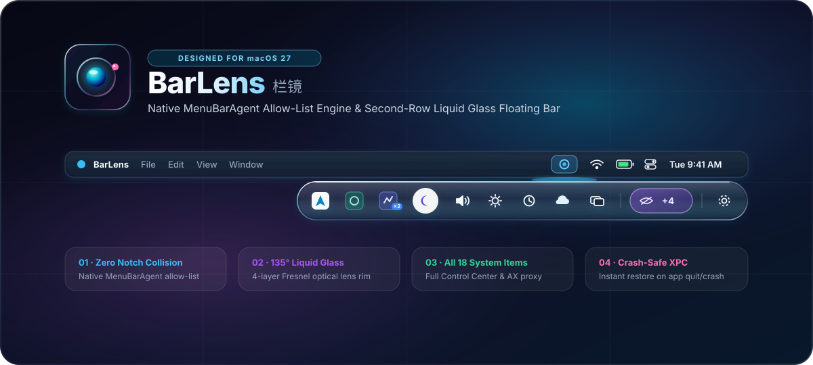
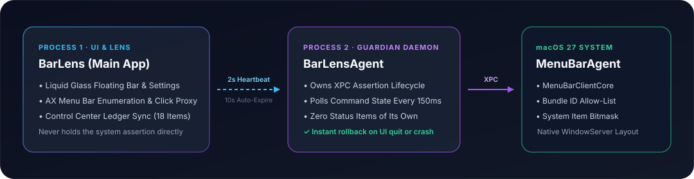

<div align="center">



<br/>

[](#requirements--installation)
[](#building-from-source)
[](#1-second-row-liquid-glass-optical-capsule)
[](#2-three-tier-section-model)
[](LICENSE)

<p align="center">
  <b>English</b> · <a href="README_CN.md">简体中文</a>
</p>

<p align="center">
  <b>Tame your macOS 27 menu bar without spacer-item hacks, notch collisions, or screen-capture lag.</b><br/>
  Powered by macOS 27's native <code>MenuBarAgent</code> allow-list architecture and a custom 4-layer <b>Liquid Glass</b> optical floating bar.
</p>

</div>

---

## ✨ Why BarLens?

Traditional macOS menu bar managers work by inserting an ultra-wide invisible `NSStatusItem` (`length = 10,000pt`) to shove icons off the left edge of the screen—or by taking continuous screen recordings to draw a fake second bar. On MacBook Pro notch displays and **macOS 27**, those approaches suffer from swallowed icons, layout jitter, and unnecessary Screen Recording permissions.

**BarLens** takes a fundamentally different, native approach built exclusively for **macOS 27**:

| Capability | Legacy Spacer / Capture Managers | **BarLens (macOS 27 Native)** |
| :--- | :--- | :--- |
| **Hiding Mechanism** | Expands dummy `NSStatusItem` to push icons off-screen | **Native `MenuBarAgent` bundle allow-list & bitmask** |
| **MacBook Notch Safety** | Icons frequently get trapped behind the camera housing | **100% immune to notch overflow** — hidden items are removed from layout cleanly |
| **Second-Row Floating Bar** | Requires Screen Recording permission to crop pixel strips | **Vector / AppKit native icons + AX press proxy** (No Screen Recording needed) |
| **Built-In System Controls** | Cannot hide or rearrange Apple's system menu extras | **Full control over all 18 macOS 27 System Settings menu bar items** |
| **Crash / Force-Quit Safety** | Leaves spacer items or broken positions behind | **Dual-process XPC assertion** — quitting or crashing restores all icons instantaneously |

---

## 🔮 Highlights

### 1. Second-Row Liquid Glass Optical Capsule & Loupe
Click the **Eclipse Halo** trigger in your menu bar to unfurl hidden items in a pure single-piece **Liquid Glass** capsule nestled `4pt` beneath the top menu bar:
- **4-Layer Optical Rim (`LiquidGlassRim`)**: Outer depth contour, inner cushion vignette, 135° Fresnel specular highlight, and top caustic sheen.
- **Zero-Capture Optical Lens Loupe & Action Tunneling (`光学透视浮窗与多级子菜单直达`)**: Pure icon capsule at rest; hover any icon to bloom an icon-anchored Liquid Glass loupe showing unread counts (Status Item + Dock badge fusion), live process memory/CPU vitals (`proc_pid_rusage`), structured telemetry rows, multi-icon module chips, active window raising, media transport controls, interactive system controls (volume slider, audio output switcher, input source switcher, local IP copy, wireless HID battery levels), and **hover-expandable multi-level `AXMenu` submenu action tunneling**—all with zero Screen Recording permission.
- **Click-to-Open & Click-to-Collapse**: Click any third-party app or system icon inside the floating bar to invoke its native macOS menu in-place; click again (or click outside) to collapse smoothly.
- **Drag-and-Drop Icon Reordering**: Drag icons directly inside the floating bar (or use right-click `Move to Front` / `Move to End`) to arrange your hidden items in any custom order.
- **3 Built-In Optical Presets**: Switch effortlessly between **Crystal Lens** (default), **Obsidian Glass**, and **Prism Sheen**, or fine-tune **Glass Density** (`8%–75%`) and **Refractive Rim Intensity** (`40%–150%`) with a live interactive preview stage.

### 2. Three-Tier Section Model & Spatial Budget Guard
Organize every application and built-in system item into three clear lists:
```text
Visible (始终显示)   ·   Hidden (可隐藏)   ·   Always Hidden (永久隐藏)
```
- **Spatial Budget & Notch Overflow Guard (`顶栏容量保护`)**: Measures MacBook Notch `NSScreen.auxiliaryTopRightArea`, frontmost app `AXMenuBar` width, or optional `5 / 8 / 12` visible-slot budgets (stabilized with hysteresis) to gracefully tuck overflow **Visible** apps into a leading **Tucked** cluster inside the Floating Bar instead of letting macOS swallow them—complete with per-app **Pin to Menu Bar** exemptions.
- **Per-Application Grouping**: Hiding operates by bundle identifier, so multi-icon apps move together cleanly without stranding orphan status items.
- **One-Click Peek Pill**: When **Always Hidden** items exist, a compact purple glass badge (`+N`) appears inside the floating bar so you can peek at rarely used items on demand.
- **Portable JSON Profile Backup**: Export and import your entire configuration (sections, custom icon order, hotkeys, and Liquid Glass optical tuning) as a single `BarLens-Profile.json` file.
- **Interactive Onboarding & Built-In User Guide**: First-launch 4-step Liquid Glass setup tour (live `/Applications` & Accessibility checks, section setup, presentation picker, and gesture cheat sheet) plus an in-app **Guide (`使用指南`)** pane accessible anytime.
- **Live Bilingual UI**: Switch dynamically between **Follow System**, **English**, and **简体中文** from Settings or via the floating bar gear context menu.

### 3. Complete Support for All 18 macOS 27 System Menu Bar Items
BarLens integrates with both `MenuBarClientCore` assessment bitmasks and `com.apple.controlcenter` ByHost preferences to manage all 18 built-in macOS 27 menu bar items—including **Wi-Fi**, **Bluetooth**, **Battery**, **Focus**, **Sound**, **Display**, **Screen Mirroring**, **Keyboard Brightness**, **Control Center**, **Clock**, **Weather**, **Timer**, **Passwords**, **Time Machine**, **Input Menu**, **Spotlight**, **Siri**, and **Stage Manager**.

### 4. Dual-Process Crash-Safe Architecture

<div align="center">
  
</div>

- **`BarLens` (Main UI Process)**: Renders the Liquid Glass floating bar, Quick Panel, and Settings window, and performs Accessibility enumeration. It **never** holds the system visibility assertion itself.
- **`BarLensAgent` (Guardian Helper)**: Holds the `MBAssessmentModeAssertion` XPC connection and polls a heartbeat command file inside `~/Library/Application Support/BarLens/` every `150ms` (with strict `0700`/`0600` permissions and `lstat` UID verification). If the UI app quits—or even if it is killed with `kill -9`—the helper automatically releases the assertion and exits, restoring every hidden icon to your menu bar immediately.

---

## 🖱️ Gestures & Shortcuts

| Action | Behavior |
| :--- | :--- |
| **Left Click** on Trigger | Reveal or collapse the **Hidden** section (Floating Bar or Inline) |
| **Double Click** on Trigger | Reveal or collapse both **Hidden** and **Always Hidden** sections |
| **Hover** on Trigger *(Optional)* | Automatically reveal **Hidden** section after configurable dwell (`0.18s / 0.35s / 0.6s`) |
| **Scroll / Swipe** on Trigger | Swipe/scroll down or left to reveal (**Hidden** → **All**); up or right to collapse |
| **Right Click** on Trigger | Open the **Liquid Glass Quick Panel** (section counts, quick toggles, bulk assign) |
| **Click Icon in Floating Bar** | Open the item's native menu; click the same icon again to close |
| **Drag Icon in Floating Bar** | Reorder icons inside the Floating Bar with live 1:1 spring animation |
| **Right Click Icon in Floating Bar** | Quick actions: step left/right, move to front/end, switch section, Show in Finder, or Quit app |
| **Right Click Gear in Floating Bar** | Quick-switch **Appearance Mode**, **Icon Style**, **Language**, or reset icon order |
| **⌘ + Drag** on Trigger | Reposition the trigger icon anywhere on the macOS menu bar |

---

## 📦 Requirements & Installation

### Requirements
- **macOS 27.0 or later** (`LSMinimumSystemVersion = 27.0` in [`Resources/Info.plist`](Resources/Info.plist). Note: [`Package.swift`](Package.swift) sets `.macOS(.v14)` solely as the SwiftPM 5.9 compiler target baseline so unit tests can execute on standard CI runners; the runtime private frameworks require macOS 27.0+).
- **Must be installed in `/Applications/BarLens.app`** *(See architectural note below).*
- **Accessibility Permission** *(Used to enumerate menu bar items and proxy clicks).*

### Install from Release DMG / ZIP
1. Download `BarLens-1.0.2.dmg` from **Releases** and drag **`BarLens.app`** into **`/Applications`**.
2. Clear the quarantine flag on first launch (since open-source builds are self-signed):
   ```bash
   xattr -d com.apple.quarantine /Applications/BarLens.app
   ```
3. Launch `/Applications/BarLens.app` and grant **Accessibility** permission when prompted.

<details>
<summary><b>💡 Why must BarLens live in <code>/Applications</code>? (Click to expand)</b></summary>
<br/>

On **macOS 27**, `MenuBarAgent` tracks every status item in its internal ledger under the key `status:<identity>::<autosaveName>`:
- When an app resides in `/Applications`, LaunchServices registers its bundle and `MenuBarAgent` keys its status item by **`CFBundleIdentifier`** (`com.barlens.app`).
- When an app runs from a temporary or build directory (`~/Desktop`, `.build/`, `/tmp`), `MenuBarAgent` falls back to keying the item by **process name**.

While a visibility restriction is active, `MenuBarAgent` filters allowed items strictly by **bundle identifier**. Running outside `/Applications` would cause `MenuBarAgent` to silently stop drawing BarLens's own trigger icon. Installing to `/Applications/BarLens.app` guarantees rock-solid registration.
</details>

---

## 🛠️ Building from Source

### Quick Start (Works Out of the Box)
`./build.sh` automatically uses a local `BarLens Dev` certificate if present, or **falls back to ad-hoc signing (`--sign -`)** with a warning so `git clone && ./build.sh` works immediately:

```bash
# Run the test suite (75 unit tests)
swift test

# Build and install to /Applications/BarLens.app
CONFIG=release ./build.sh

# Launch BarLens
open -a /Applications/BarLens.app

# Optional: Package a distributable DMG (and optional ZIP with MAKE_ZIP=1)
./make-dmg.sh
```

### Optional: Create a Persistent Local Code-Signing Certificate
macOS ties Accessibility TCC grants to an app's code signature. If you rebuild frequently, creating a one-time self-signed certificate named `BarLens Dev` prevents macOS from asking you to re-toggle Accessibility permission after each build:

```bash
read -rsp "Enter a temporary password for PKCS#12 export: " CERT_PASS && echo
openssl req -x509 -newkey rsa:2048 -sha256 -days 3650 -nodes \
  -keyout key.pem -out cert.pem -config <(printf '%s\n' \
    '[req]' 'distinguished_name=dn' 'x509_extensions=codesign' 'prompt=no' \
    '[dn]' 'CN=BarLens Dev' \
    '[codesign]' 'basicConstraints=critical,CA:false' \
    'keyUsage=critical,digitalSignature' 'extendedKeyUsage=critical,codeSigning')
openssl pkcs12 -export -legacy -out dev.p12 -inkey key.pem -in cert.pem -passout env:CERT_PASS
security import dev.p12 -k ~/Library/Keychains/login.keychain-db -P "$CERT_PASS" -T /usr/bin/codesign
security add-trusted-cert -r trustRoot -p codeSign \
  -k ~/Library/Keychains/login.keychain-db cert.pem
unset CERT_PASS
rm -f key.pem cert.pem dev.p12
```

---

## ⚠️ Caveats & Disclaimer

1. **Private Apple Frameworks & Symbols**: BarLens dynamically loads `/System/Library/PrivateFrameworks/MenuBarClientCore.framework` (`MBAssessmentModeAssertion`) in [`Sources/CMenuBarPrivate/MenuBarPrivate.m`](Sources/CMenuBarPrivate/MenuBarPrivate.m) and resolves `MBSystemItemIdentifier` Swift symbols via `dlsym` in [`Sources/BarLens/SystemItem.swift`](Sources/BarLens/SystemItem.swift).
2. **Not Eligible for the Mac App Store**: Because BarLens runs unsandboxed, uses Accessibility press proxying, and links private system frameworks, it cannot be distributed on the Mac App Store.
3. **OS Upgrade Compatibility & Fail-Open Design**: Apple may change or remove `MenuBarClientCore` or `MenuBarAgent` internals in future macOS updates without notice. BarLens is designed to **fail open**—if the private framework or symbols are unavailable, no visibility restriction is applied, and quitting or force-killing the app immediately releases all XPC assertions and restores every menu bar icon.
4. **Use at Your Own Risk**: This software is provided "as is" without warranty of any kind. See [`SECURITY.md`](SECURITY.md) and [`LICENSE`](LICENSE) for details.

---

## 📄 License

Released under the [MIT License](LICENSE).
