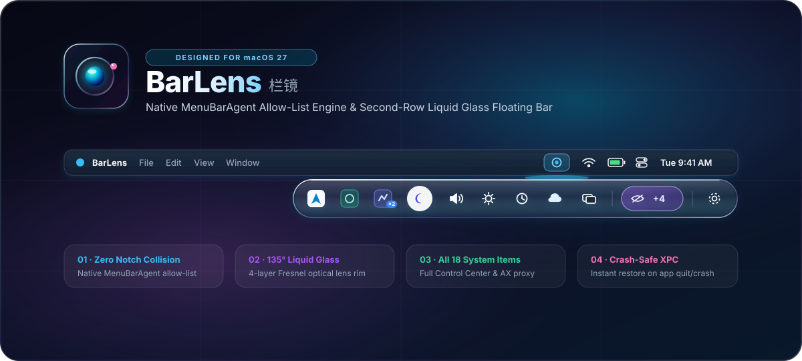
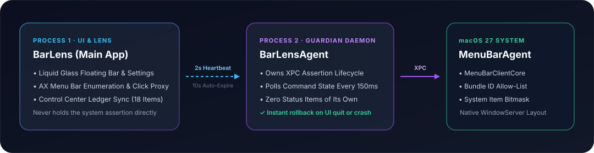

<div align="center">



<br/>

[](#系统要求与安装)
[](#从源码编译)
[](#核心亮点)
[](#核心亮点)
[](LICENSE)

<p align="center">
  <a href="README.md">English</a> · <b>简体中文</b>
</p>

<p align="center">
  <b>专为 macOS 27 原生架构打造的菜单栏图标整理与 Liquid Glass 第二栏光学悬浮透镜。</b><br/>
  告别旧时代“拉长空白分隔条硬挤图标”与“录屏截图拼接”，原生无闪烁、不惧刘海屏。
</p>

</div>

---

## ✨ 为什么选择 BarLens？

传统 macOS 菜单栏管理工具大多依赖“插入超宽空白 `NSStatusItem` 把左侧图标强行挤出屏幕或挤进刘海”或“持续申请录屏权限截取菜单栏像素”。在 MacBook 刘海屏与 **macOS 27** 新架构下，传统方案不仅容易吞图标、布局闪烁，还需要额外的录屏权限。

**BarLens** 专为 **macOS 27** 原生架构重新设计：

| 能力对比 | 传统分隔条 / 录屏方案 | **BarLens (macOS 27 原生架构)** |
| :--- | :--- | :--- |
| **底层隐藏机制** | 拉长空白 `NSStatusItem` 硬挤坐标 | **原生 `MenuBarAgent` Bundle 白名单与位掩码** |
| **MacBook 刘海屏兼容性** | 图标极易卡在摄像头刘海区域下方 | **100% 免受刘海干扰** —— 隐藏项直接从系统布局移除 |
| **第二栏悬浮条实现** | 需开启“屏幕录制”权限实时截图拼接 | **原生矢量图标 + AX 代理点击**（无需录屏权限） |
| **系统内置图标控制** | 无法隐藏或单独管理控制中心系统图标 | **完整支持 macOS 27「系统设置 → 菜单栏」全部 18 项系统控件** |
| **防崩溃安全保障** | 强退后残留空白占位条或图标丢失 | **双进程 XPC 断言架构** —— 退出或崩溃瞬间自动恢复全部图标 |

---

## 🔮 核心亮点

### 1. Liquid Glass（液态光学玻璃）悬浮胶囊与光学透视浮窗
单击菜单栏上的 **日蚀光环** 触发图标，即可在顶部菜单栏下方 `4pt` 处展开纯粹的一体式 **Liquid Glass** 光学胶囊：
- **4 层光学折射边缘（`LiquidGlassRim`）**：外层景深轮廓、内层边缘暗角晕影、135° 菲涅尔高光折射边与顶部镜面焦散亮线。
- **零截屏「光学透视浮窗」与多级子菜单直达（Optical Lens Loupe & Action Tunneling）**：平时保持纯粹极简图标胶囊；悬停任意图标即在正下方展开同材质液态玻璃透视浮窗，呈现未读角标（融合菜单栏与程序坞徽标）、实时进程内存/CPU 占用（`proc_pid_rusage`）、结构化状态读数、多图标模块独立唤起、活动窗口一键前置、通用音乐媒体控制、可交互系统控件（音量滑块、音频输出切换、输入法切换、本机 IP 复制、蓝牙外设电量、高刷显示器参数），并支持**悬停滑出次级浮窗的多级 `AXMenu` 子菜单闭环直达**，全程无需屏幕录制权限。
- **原位点按展开 / 再次点按收起**：在悬浮栏内点击任意第三方应用或系统图标即可原位唤起其原生菜单；再次点击同一图标或点击外部区域即可平滑收起。
- **悬浮栏图标拖拽排序与右键快捷操作**：支持直接在悬浮栏内左右拖拽调整图标顺序，或右键任意图标快速执行左移 / 右移、置顶 / 置底、切换分区、锁定顶栏常驻、在访达中显示及退出应用。
- **悬停展开与触控板 / 滚轮手势**：支持配置鼠标悬停触发图标自动展开（`0.18s / 0.35s / 0.6s`），以及在触发图标上双指下滑 / 左滑（或滚轮下滚）逐级展开、上滑 / 右滑收起。
- **3 套一键光学预设 + 实时预览台**：内置 **「最佳冰晶透镜」**、**「深邃黑曜石」**、**「高透棱镜流光」** 三套预设，支持无级调节玻璃浓度与折射边强度。

### 2. 智能自治菜单栏与顶栏容量保护
```text
始终显示 (Visible)   ·   可隐藏 (Hidden)   ·   永久隐藏 (Always Hidden)
```
- **投屏 / 会议共享净空盾（Presentation Shield）**：无需录屏权限，自动感知各类会议软件与浏览器的共享屏幕（`ScreenCaptureKit` / `CGDisplayStream`）以及显示器硬件镜像 / AirPlay（`CGDisplayIsInMirrorSet`）（纯语音/摄像头通话不误触，亦支持右键快捷面板胶囊或全局快捷键一键开关），结束共享或投屏瞬间原样恢复布局。
- **零截屏「隐藏项状态突变冒泡」（Zero-Capture Status Bubble-Up）**：无需屏幕录制权限，自动感知「可隐藏」应用的未读数增长、告警升级与离散状态切换，智能过滤网速、百分比、计时器与滚动歌词等高频噪音；内置 **「智能驻留」** 退场闭环（未读与告警保持浮现直至点击处理、切入应用或恢复正常，普通状态变更轻快展示后自动隐退，指针位于顶栏时自动防躲闪锁止）。
- **低频图标自动沉淀（Usage Auto-Decay）**：统一追踪原生顶栏与悬浮栏真实点击热度，将超过 `3 / 7 / 14 / 30` 天未交互的「始终显示」第三方图标自动沉淀至「可隐藏」（内置宽限期保护与一键立即清理），并支持单应用「锁定顶栏常驻」永久豁免。
- **顶栏容量保护与防刘海吞噬（Spatial Budget Guard）**：实时测量 MacBook 物理刘海右侧净空（`auxiliaryTopRightArea`）与前台应用菜单栏宽度，并支持可选 `5 / 8 / 12` 席位上限（内置回滞防抖）；空间吃紧时按低频优先将超出的「始终显示」图标暂收到悬浮栏前端，且共享「锁定顶栏常驻」豁免锁。
- **按应用整体归类**：同一应用的多个状态栏图标同步显隐，不留残余。
- **配置文件一键导入 / 导出**：支持将所有分区规则、悬浮栏自定义排序、快捷键与光学参数导出为 `BarLens-Profile.json` 备份或迁移。
- **首次安装引导与内置使用指南**：首次启动自动呈现 4 步交互式 Liquid Glass 新手引导（环境自检、三段式分区配置、呈现风格实时体验与手势速览），并内置「设置 → 使用指南」随时查阅或重播引导。
- **支持中英双语实时切换**：可在「设置 → 通用 → 界面语言」或直接右键悬浮栏齿轮按钮，在 **跟随系统 / English / 简体中文** 之间无感切换。

### 3. 完整支持 macOS 27 全部 18 项系统菜单栏控件
深度联动 `MenuBarClientCore` 与 `com.apple.controlcenter` 系统账本，支持无线局域网、蓝牙、电池、专注模式、声音、显示器、屏幕镜像、键盘亮度、控制中心、时钟、天气、计时器、密码、时间机器、文字输入、聚焦、Siri、台前调度等全部系统项。

### 4. 双进程防崩溃安全架构

<div align="center">
  
</div>

- **`BarLens`（主进程）**：负责 UI、Liquid Glass 悬浮栏、AX 菜单栏枚举与点击代理，自身绝不直接持有系统隐藏断言。
- **`BarLensAgent`（守护进程）**：独立持有 `MBAssessmentModeAssertion` XPC 连接，每 `150ms` 轮询 `~/Library/Application Support/BarLens/` 下的主进程心跳（文件 IPC 采用 `0700`/`0600` 权限与 `lstat` UID 归属校验）。一旦主进程退出或被强制杀死，守护进程会自动释放断言并退出，所有隐藏图标立即恢复显示。

---

## 📦 系统要求与安装

### 系统要求
- **macOS 27.0 及以上版本**（[`Resources/Info.plist`](Resources/Info.plist) 已配置 `LSMinimumSystemVersion = 27.0`；注：[`Package.swift`](Package.swift) 中的 `.macOS(.v14)` 仅作为 SwiftPM 5.9 编译器与标准 CI 单元测试运行基线，实际运行依赖 macOS 27 独有的 `MenuBarClientCore.framework` 与 `MenuBarAgent` 架构）。
- **必须安装在 `/Applications/BarLens.app`**（系统 `MenuBarAgent` 仅对安装在标准应用程序目录的 App 按 Bundle ID `com.barlens.app` 记账）。
- **辅助功能（Accessibility）权限**（用于读取菜单栏布局并代理触发菜单点击）。

### 安装步骤
1. 下载 `BarLens-1.1.0.dmg` 并打开，将 **`BarLens.app`** 拖入 **`/Applications`** 文件夹。
2. 首次打开自签名开源包若遇 Gatekeeper 提示，可在终端执行：
   ```bash
   xattr -d com.apple.quarantine /Applications/BarLens.app
   ```
3. 启动 `/Applications/BarLens.app`，按提示授予「辅助功能」权限即可使用。

---

## 🛠️ 从源码编译

`./build.sh` 在未检测到本地开发证书时会自动回退为 **ad-hoc 临时签名（`--sign -`）** 并打印提示，因此克隆仓库后可直接编译运行：

```bash
# 运行单元测试（88 项测试）
swift test

# 编译 Release 版本并安装到 /Applications/BarLens.app
CONFIG=release ./build.sh

# 启动 BarLens
open -a /Applications/BarLens.app

# 打包可分发的 DMG 镜像（设置 MAKE_ZIP=1 可同时生成 ZIP 包）
./make-dmg.sh
```
> - **可选固定签名证书**：若频繁本地重编译，可参考 [`build.sh`](build.sh) 顶部注释或英文 [`README.md`](README.md#building-from-source) 创建一张本地自签名证书 `BarLens Dev`，避免每次重编译后重新勾选辅助功能权限。
> - **架构与贡献指南**：请参见 [`CONTRIBUTING.md`](CONTRIBUTING.md)。

---

## ⚠️ 已知限制与免责声明（Caveats & Disclaimer）

1. **依赖 Apple 私有框架与未公开符号**：本项目在 [`Sources/CMenuBarPrivate/MenuBarPrivate.m`](Sources/CMenuBarPrivate/MenuBarPrivate.m) 中通过 `dlopen` 动态加载 `/System/Library/PrivateFrameworks/MenuBarClientCore.framework`（`MBAssessmentModeAssertion`），并在 [`Sources/BarLens/SystemItem.swift`](Sources/BarLens/SystemItem.swift) 中通过 `dlsym` 解析私有 `MBSystemItemIdentifier` 符号。
2. **无法上架 Mac App Store**：由于需要非沙盒环境、辅助功能点击代理及私有系统框架调用，本应用无法提交至 Mac App Store 分发。
3. **系统升级兼容性与 Fail-Open 安全设计**：Apple 可能在未来的 macOS 更新中修改或移除相关私有 API。BarLens 采用 **Fail-Open（故障安全开放）** 策略——当私有框架或符号不可用时不会施加任何隐藏限制，且主进程退出或被强制终止时，守护进程会立即释放 XPC 断言并恢复所有菜单栏图标。
4. **风险自负**：本软件按“原样（AS IS）”提供，不作任何明示或暗示担保。详见 [`SECURITY.md`](SECURITY.md) 与 [`LICENSE`](LICENSE)。

---

## 📄 开源协议

基于 [MIT License](LICENSE) 开源。
